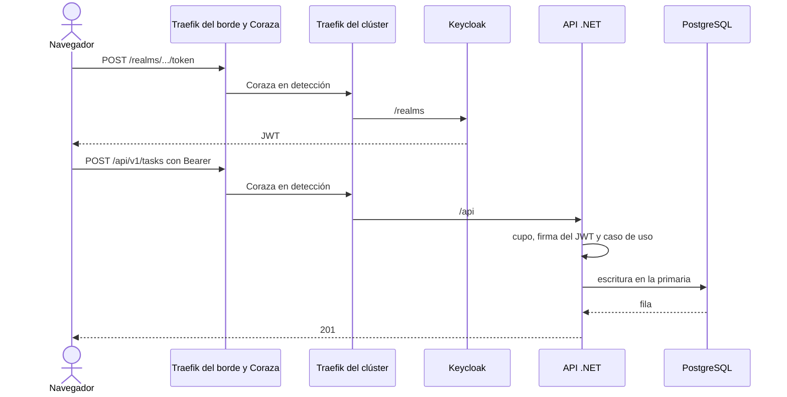

# Task Manager

La idea es un sistema que aguante ciberataques y fallas naturales del propio entorno: un nodo que se cae, un pod que desaparece o una ráfaga de peticiones. Es un solo servicio de tareas, no una malla de microservicios. La API es .NET 9 con arquitectura limpia en cortes verticales. El frontend es React. En el laboratorio, Kubernetes (k3d) simula tres máquinas en un solo ordenador: un master y dos agentes. En cada nodo viven el frontend, la API y una réplica de la base. El ingreso es Traefik, en `http://localhost:8088`, y la autenticación es JWT de Keycloak.

## Flujo de una solicitud

En un servidor con certificado el navegador hablaría HTTPS y Traefik terminaría el TLS. Este laboratorio no tiene certificado: la solicitud entra en claro por `http://localhost:8088`. El resto del camino es el mismo.

El ejemplo es crear una tarea. Primero el navegador pide un token. Después envía la tarea con ese token.



`/health` sigue el mismo ingreso y termina en la API. `/` termina en nginx, que sirve React. `/waf-probe` no pasa: Coraza lo bloquea con 403. `/grafana` termina en Grafana.

| Tecnología | Para qué está |
|---|---|
| Docker | Ejecuta el motor donde viven los nodos k3d, el Traefik del borde y el resto de contenedores. |
| k3d y k3s | Levantan Kubernetes en Docker: un master y dos agentes, como tres máquinas en un solo equipo. |
| Kubernetes | Programa los pods, los reparte entre nodos y vuelve a crear los que se caen. |
| Traefik del borde | Única puerta del host, en el puerto 8088. Reparte entre los tres nodos. |
| Coraza y OWASP CRS | Cortafuegos de aplicación. En `/api`, `/health` y `/` solo detecta. En `/waf-probe` bloquea. |
| Traefik del clúster | Elige el servicio según la ruta: Keycloak, la API, el frontend o Grafana. |
| nginx | Sirve el frontend ya compilado. No ejecuta la lógica de las tareas. |
| React | Pantallas de login y de tareas. Llama a la API del mismo origen. |
| Keycloak | Emite el JWT de `dev-user` y `admin-user`. |
| API .NET 9 | Aplica el cupo, valida el JWT y ejecuta el caso de uso en cortes verticales. |
| PostgreSQL | Guarda las tareas. Una réplica acepta escrituras y las otras copian el WAL. |
| OpenTelemetry, Prometheus, Loki y Grafana | La API empuja métricas y logs por OTLP al collector. Prometheus los raspa y Loki guarda los logs. Grafana solo consulta esos dos almacenes. Las trazas no se almacenan. |

## Datos de Grafana

Grafana no observa la API. Lee lo que Prometheus y Loki ya guardaron.

La API, con `OpenTelemetry__OtlpEndpoint` en `http://otel-collector.taskmanagement.svc.cluster.local:4317`, envía métricas y logs por OTLP gRPC. El collector agrupa las métricas y las publica en el puerto 8889. Prometheus las raspa cada 15 segundos. Los logs de Serilog siguen el mismo OTLP y el collector los entrega a Loki. Grafana entra por `http://localhost:8088/grafana/` y consulta esos dos orígenes: el tablero `API overview` (tasa, p95, heap y logs) y `System Resilience`.

Las trazas salen de la API y se quedan en la consola del collector. No hay un almacén de trazas conectado a Grafana. El detalle está en `docs/observability/monitoring.md`.

## Cómo levantar todo el sistema

Hace falta Windows 11 con al menos 16 GB de RAM. Con menos, el motor de Docker se cae cuando corren k6 y Chaos Mesh. En Docker Desktop, Resources, la memoria del motor tiene que estar en 8 GB. Es lo recomendado para correr las pruebas. Con 2 GB el clúster no llega a responder.

Además del SDK de .NET 9 y de Node 20:

- Docker Desktop en ejecución
- k3d 5.8 y kubectl
- k6, Trivy y Playwright, solo si vas a lanzar la suite
- La imagen de OWASP ZAP la descarga el script de la línea base

Desde la raíz del repositorio:

```powershell
Copy-Item .env.example .env
docker build -f src/TaskManagement.API/Dockerfile -t taskmanagement-api:local .
docker build -f src/TaskManagement.Web/Dockerfile -t taskmanagement-web:local src/TaskManagement.Web
./infrastructure/local/scripts/Deploy-Cluster.ps1
```

`Deploy-Cluster.ps1` crea el clúster `taskmanagement` (1 servidor y 2 agentes), importa las imágenes, aplica los manifiestos, espera la migración, instala Chaos Mesh 2.7.2 y conecta el Traefik del borde. La aplicación queda en `http://localhost:8088`. Grafana está en `http://localhost:8088/grafana/`.

Usuarios del laboratorio, con las contraseñas de `.env` (`lab-dev-user` y `lab-admin-user` si no las cambias): `dev-user` y `admin-user`.

Para quitar el clúster:

```powershell
./infrastructure/local/scripts/Remove-K3dCluster.ps1
```

### Solo la API en el host, sin Kubernetes

```powershell
docker compose -f infrastructure/database/docker-compose.yml up -d
dotnet run --project src/TaskManagement.API --launch-profile http
```

La API queda en `http://localhost:5080`. En Development, una petición sin `Authorization` usa `dev-user`.

```powershell
cd src/TaskManagement.Web
npm install
npm run dev
```

El frontend de desarrollo queda en `http://localhost:5173`.

## Pruebas

Con el clúster ya desplegado:

```powershell
./infrastructure/local/scripts/Invoke-Tests.ps1
```

El script encadena las pruebas mientras se llama a la API y se comprueba que la respuesta coincide con lo que el negocio espera (alta, lectura, conflicto de versión, acceso, roles). El workflow de GitHub no lanza esta suite: solo corre unitarias, arquitectura, el build de integración, las imágenes y Trivy sobre el repositorio.

1. El frontend entra y crea tareas mientras corren los escenarios k6 y, después, la resiliencia.
2. Arquitectura, unitarias, contrato de la API, Trivy, cabeceras, CORS, acceso, roles, límite de tasa, cuerpo JSON y la línea base de ZAP.

k6, con `SUITE=1`, cubre humo, carga, estrés, pico, resistencia, tráfico mixto y límite. La resiliencia pide a Chaos Mesh que mate dos pods de la API y, aparte, para los dos agentes con `docker stop`. El master tiene que seguir respondiendo `200` en `/health/ready`. El límite de tasa no se mide a través del balanceador: el test abre un `port-forward` a un solo pod. Si el lote se reparte entre las tres réplicas, Traefik impide llenar el cupo de ninguna, y un lote grande tira el proxy de Docker.

## Decisiones

El objetivo es resistir un ataque y una falla del sistema, no solo que la API arranque.

No usé microservicios. La tarea es un único servicio, y partirlo en servicios pequeños no aporta resistencia: añade red y despliegues. La arquitectura es limpia, en cortes verticales: dominio, aplicación, infraestructura y la API. El frontend es otro proceso, detrás del mismo ingreso.

La resistencia está en el despliegue. k3d simula tres máquinas. En cada nodo hay frontend, API y una réplica de PostgreSQL. Solo una réplica de la base acepta escrituras; las otras siguen el WAL. Si caen pods o los dos agentes, el master sigue sirviendo. Keycloak, Coraza en el borde, los límites por réplica, Trivy y ZAP cubren la parte de ataque. k6 y Chaos Mesh cubren la sobrecarga y la falla.

| Pieza | Qué se usó |
|---|---|
| Código | .NET 9, cortes verticales, React |
| Clúster | k3d, 1 master y 2 agentes, 3 réplicas de API, frontend y PostgreSQL |
| Ingreso | Traefik en el borde (`localhost:8088`) y un Ingress dentro del clúster |
| Identidad | Keycloak, JWT |
| Ataque | Coraza, límite de tasa, Trivy, ZAP baseline |
| Falla | Chaos Mesh (dos pods de la API) y parada manual de los dos agentes |
| Carga | k6: humo, carga, estrés, pico, resistencia, mixto y límite |
| Negocio | Playwright y pruebas de integración contra la API publicada |
| Recursos | Host de 16 GB. Motor de Docker en 8 GB |

## Con más tiempo

Los tests los correría en varios ordenadores conectados entre sí, con la misma arquitectura que ahora se simula en una sola máquina. Cada nodo dejaría de ser un contenedor de k3d y pasaría a ser un equipo. Así la caída de un agente y el tráfico de k6 no dependerían del proxy de Docker de un portátil. También extendería la lógica de negocios para desarrollar otros servicios relacionados y así justificar una arquitectura de microservicios donde cada servicio es un sistema k3d igual que este.

## Qué le pedí a la IA

Indagué qué prácticas de ciberseguridad podía implementar además de las que ya conocía. De ahí salieron la línea base de ZAP y el análisis de Trivy.

Luego pensé en una arquitectura resiliente. En sistemas distribuidos hay varias, y una arquitectura en la que cada pod tenga sea autosuficiente es la arquitectura que más consume recursos pero dada que busco la resiliencia máxima uso esta. En otras arquitectura si se caen 2 nodos de 3, el sistema pierde información.

Pedí Kubernetes con k3d: dos agentes y un master. Las pruebas de Chaos Mesh matan pods de la API. Las pruebas manuales tiran los dos agentes y exigen un `200` de la salud de la API. Pedí los casos típicos de k6 que simulan sobrecarga, todos dentro de un script que los corre mientras se hacen peticiones y se comprueba que la respuesta es la que el modelo de negocio espera.

Correr eso en Windows 11 pide un equipo de al menos 16 GB de RAM. Con menos, el contenedor de Docker se cae en k6 y en Chaos Mesh. Subí la memoria del motor a 8 GB para que las pruebas aguanten. Los tests de límite de tasa se redirigieron a un solo pod: si no, Traefik reparte el lote entre las tres instancias y un lote grande, pensado para saturarlas, tira el proxy de Docker.

Más detalle en `docs/setup.md`, `docs/deployment/k3d.md` y `docs/reports/summary.md`.
