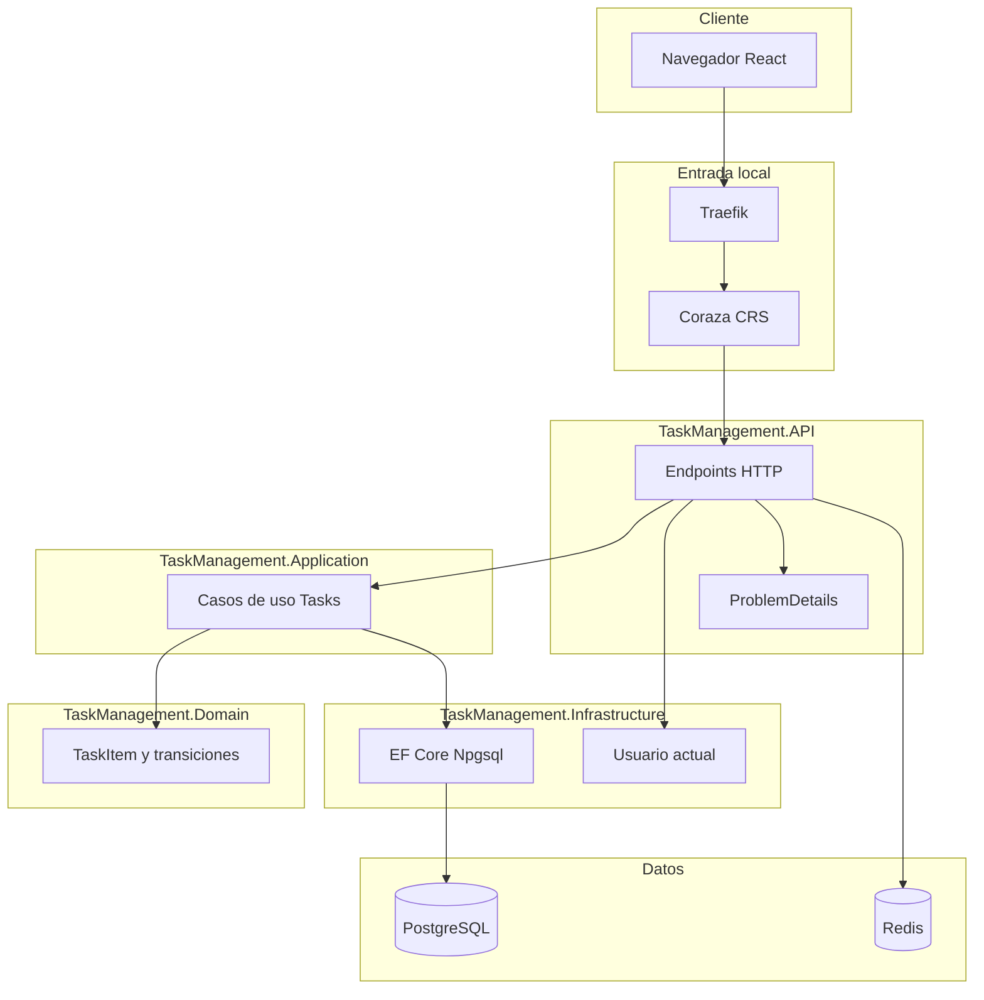

# Diagrama de componentes

Una petición de escritura entra por Traefik y el WAF, llega al endpoint, el caso de uso aplica las reglas de `TaskItem` y Infrastructure guarda el resultado en PostgreSQL. Las lecturas siguen el mismo camino y proyectan filas sin duplicar la base.
