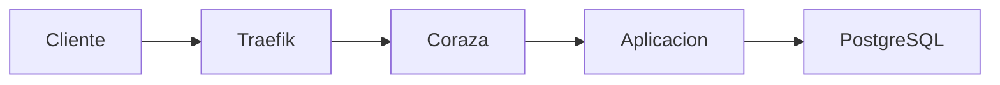

# Exposición

Traefik está en la red pública, donde publica `8088`, y en la red interna `taskmanagement-internal`. El destino de la aplicación solo está en esa red interna, así que no tiene puerto en el host ni salida directa. No hay una ruta de la API que evite Coraza.



PostgreSQL, Keycloak y la observabilidad siguen en sus puertos de laboratorio para operar el entorno. No forman el ingreso de la aplicación.

```powershell
./infrastructure/edge/Test-NoBypass.ps1
```
