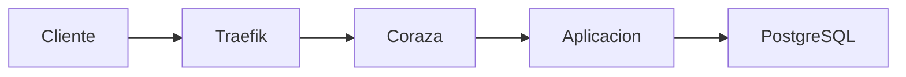

# Exposición

Traefik está en la red pública, donde publica `8088`, y en la red interna `taskmanagement-internal`. El clúster k3d no publica la aplicación en el host. Traefik se une a la red `k3d-taskmanagement` y reenvía a los nodos, donde escucha el ingreso del clúster. No hay una ruta de la API que evite Coraza.



PostgreSQL, Keycloak y la observabilidad siguen en sus puertos de laboratorio para operar el entorno. No forman el ingreso de la aplicación.

```powershell
./infrastructure/edge/Test-NoBypass.ps1
```
