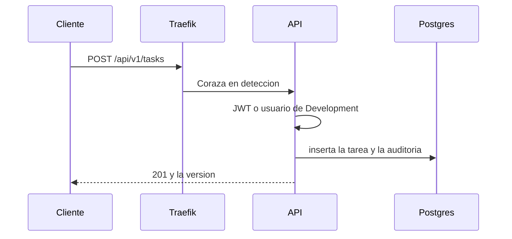

# Flujos

## Alta de una tarea

## Lectura ajena

Si el llamador no es el responsable, ni el creador, ni un administrador, la API responde 404. No indica si la fila existe.

## Salud

`/health/live` no toca la base. `/health/ready` la consulta. En el clúster solo el segundo saca el pod del Service.

## Prueba del cortafuegos

`/waf-probe` usa CRS en bloqueo. Una consulta con un patrón de inyección SQL responde 403 antes de llegar a la aplicación. El resto del ingreso queda en detección.
